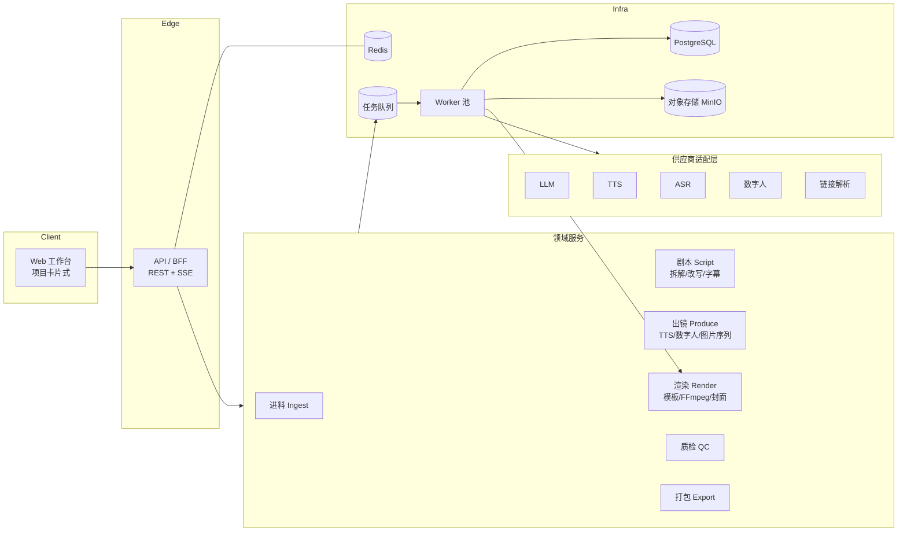

# 口播视频生产系统 · 分析与技术方案

> 需求来源：`口播视频生产流程`（Grok Bot 分享页）
> 定位：从「抖音链接 / 文案 / 视频 / 主题」到「可发布成片 + 封面 + 发布文案」的固定八步流水线。
> 本文只做**系统怎么落地**的分析，不含代码。

---

## 1. 一句话结论

这不是"一个 AI 视频生成器"，而是一条**内容生产流水线（Content Pipeline）**：
核心资产不是模型调用，而是 **模板库 + 品牌规范 + 质检规则 + 素材库 + 供应商适配层**；
核心工程问题是 **步骤可回退、产物可版本化、外部依赖可降级、成本可归因**。

第一版不要追求"全自动一键出片"，而要追求：
**固定路径 + 每步可人工介入 + 失败不卡死 + 一单固定交付 8 件产物。**

---

## 2. 需求还原

### 2.1 系统边界（必须写死在产品里）

| 边界内 | 边界外 |
| --- | --- |
| 进料、提取、改写、出镜合成、剪辑、封面、发布文案、质检、导出 | 平台账号托管、自动代发、批量养号、刷量 |
| 链接提取"尽力而为"，失败即降级 | 保证任何抖音链接都能解析成功 |
| 导出"待发布包"，附发布说明 | 直接调用抖音开放接口发布 |
| 改写必须拉开差异 | 近义词换皮式"搬运" |

> 结论：**发布永远是人做的最后一步**。系统交付物止于"待发布包"。

### 2.2 八步流程 → 工程步骤

| # | 业务步骤 | 工程步骤 ID | 输入 | 输出产物 | 是否可跳过 |
| --- | --- | --- | --- | --- | --- |
| 1 | 进料 | `intake` | 链接 / 文案 / 视频 / 主题（四选一） | `source` 记录 | 否 |
| 2 | 提取与拆解 | `extract` + `breakdown` | source | `transcript` + `breakdown`（钩子/结构/承诺） | 仅"主题进料"时跳过 |
| 3 | 差异化改写 | `rewrite` | breakdown / 原文 / 平台 / 时长 / 禁止事项 | `script` + `subtitle` | 否 |
| 4 | 选择出镜路线 | `route` | script + 用户素材 | `route_plan` | 否（有默认值） |
| 5 | 出镜与声音 | `produce` | script + route_plan | `voice` / `avatar_video` / `image_sequence` + `shot_list` | 否 |
| 6 | 模板剪辑与封面 | `render` + `cover` | 以上 + 模板 + 品牌规范 | `video.mp4` + `cover.png` | 否 |
| 7 | 发布配套 | `publish_copy` | script + 平台 | `title/desc/tags/first_comment` | 否 |
| 8 | 质检后导出 | `qc` + `export` | 全部产物 | `qc_report` + `export.zip` | 质检不可跳过，出口可强制放行 |

### 2.3 每次交付物（固定 8 件，目录固定）

```
order-{yyyyMMdd}-{seq}/
  01-source-transcript.md      # 仅链接/视频进料时有
  02-script.md                 # 改写后口播稿
  03-subtitle.srt              # 按句切开，竖屏每行 8–16 字
  04-storyboard.md             # 分镜 + 素材清单
  05-video-9x16.mp4            # 模板剪辑成片
  06-cover.png
  07-publish-copy.md           # 标题/简介/话题/首评
  08-publish-notes.md          # 发布说明 + 质检结论
```

> 工程含义：**导出是一个"目录装配"任务**，不是"下载按钮"。产物清单必须是数据驱动（DB 里定义 artifact 类型），将来加产物不改代码。

### 2.4 进料与默认值（决定前后端表单）

| 字段 | 必填 | 默认 | 备注 |
| --- | --- | --- | --- |
| 进料内容 | 是（四选一） | — | 链接 / 文案 / 视频 / 主题 |
| 平台 | 是 | 抖音 | 抖音、视频号、小红书、Reels、Shorts |
| 目标时长 | 是 | 15–30s | 需要讲清再用 45–60s |
| 口播语言 | 是 | 中文 | |
| 出镜路线 | 否 | 配音 | 配音 / 数字人 / 上传图片 |
| 图片或形象素材 | 条件必填 | — | 选「数字人」或「上传图片」时 |
| 禁止事项 | 否 | 空 | 竞品名、夸张承诺、禁用词、禁用画面 |

**交互原则：缺必填项时只补问"会卡住流程"的那几项，其余按默认值直接开工。** 这是本系统体验的关键差异点——不要做成长表单。

---

## 3. 三个核心设计判断

### 判断一：外部依赖必须"分级降级"，不能"要么成功要么失败"

进料是整条链路最容易死的地方。抖音链接解析没有稳定官方通道，所以设计成阶梯：

| 级别 | 手段 | 成本 | 成功率 | 说明 |
| --- | --- | --- | --- | --- |
| L0 | 链接规范化 | 极低 | 高 | 展开短链、取 `aweme_id`、去追踪参数 |
| L1 | 分享页/SSR JSON 解析 | 低 | 中 | 无登录态能拿到的元信息、部分文案 |
| L2 | 无头浏览器抓取 | 中 | 中高 | 需要 UA/Cookie/频控，易失效，必须可开关 |
| L3 | 用户上传视频 + ASR | 中 | 高 | **最可靠**，也是隐私最友好的路径 |
| L4 | 用户粘贴文案 / 只给主题 | 极低 | 100% | 永远可用的兜底 |

要求：
- 每一级尝试都写 `ingest_attempts` 日志（级别、原因、耗时），UI 上明确提示"已降级到 L3，因为 L1 返回空"。
- **口播视频多数没有现成字幕**，所以"提取文案"≈"下载视频 + 人声分离 + ASR"。这一点直接决定架构里必须有 ASR 服务。
- 不做"保证能解析"的承诺，避免法务与预期风险。

### 判断二：差异化的本质是"可测量的约束"，不是一句 Prompt

"改写必须拉开差异、禁止近义搬运"必须落成**可计算的门槛**，否则无法质检、无法交付：

| 指标 | 计算方式 | 建议阈值 | 用途 |
| --- | --- | --- | --- |
| 4-gram 重合率 | 最长公共子串 / 4-gram 交集占比 | < 20% | 抓"换皮" |
| 句向量相似度 | 逐句 embedding cosine，取最大值与均值 | max < 0.85，mean < 0.75 | 抓"近义搬运" |
| 结构差异 | LLM 打分（钩子类型、案例、承诺、CTA 是否全换） | 4 项中至少换 3 项 | 抓"结构照抄" |
| 单承诺检查 | LLM 抽取承诺数量 | == 1 | 抓"什么都想说" |
| 字数预算 | 目标秒数 × 4 字/秒 | ±10% | 抓"时长失控" |

流程：生成 → 自动打分 → 不达标自动重写（最多 2 次）→ 仍不达标则**转人工并给出具体差距**（例如"第 3 句与原文相似度 0.91"）。质检报告里的这一项是产品卖点，不是日志。

### 判断三：时长与字幕要在"生成前"控制，不要在"生成后"裁剪

- 中文口播约 **4 字/秒**：15s≈60 字、30s≈120 字、45s≈180 字、60s≈240 字。改写时就按字数预算下发，模型输出必须在预算内。
- TTS 实际语速有 ±15% 波动，所以合成后**实测音频时长**，用 0.9–1.1 倍速微调或删口头语，而不是硬剪。
- 字幕时间轴**直接取 TTS 返回的字级时间戳**，不要用 ASR 反推（错字 + 漂移）。没有时间戳的 TTS 供应商直接淘汰。
- 分句规则：一个 cue 一句话，单行 8–16 字，最多两行，按语义断点断，禁止在词中间断。

---

## 4. 系统架构



### 4.1 分层职责

| 层 | 职责 | 不该做的事 |
| --- | --- | --- |
| Web 工作台 | 项目列表、单项目流水线视图、逐步编辑与重跑、预览成片、导出 | 不直连供应商 |
| API / BFF | 鉴权、表单校验、编排入口、SSE 进度推送、产物签名 URL | 不跑长任务 |
| 领域服务 | 每个步骤的纯业务逻辑：输入 artifact → 输出 artifact | 不依赖 HTTP 上下文 |
| Worker | 消费任务、调供应商、写 artifact、上报进度/成本 | 不写 UI 文案 |
| 供应商适配层 | 统一接口、重试、限流、计费埋点、可切换 | 不泄露供应商字段到上层 |

**关键：领域服务是无状态纯函数式**（`run(artifacts, config) -> artifacts`），这样批量生产、重跑、A/B 模板、回归测试都免费获得。

### 4.2 部署形态（建议起步）

单机 `docker compose`：

```
web (Next.js)  api  worker(ffmpeg)  postgres  redis  minio  [asr-faster-whisper]
```

不需要 GPU 就能跑通 MVP：改写用云 LLM、配音用云 TTS、渲染用 CPU FFmpeg。GPU 只在"本地 ASR 高并发"或"自建数字人"时才需要。

---

## 5. 核心领域模型：项目状态机 + 产物 DAG

### 5.1 两层状态

```
Project.status : draft → running → needs_review → ready_to_export → exported → archived
                 ↘ failed（记录失败步骤，可重试）
Step.status    : pending → queued → running → done | failed | skipped | stale
```

### 5.2 产物 DAG（真正的骨架）

```
source ──▶ transcript ──▶ breakdown ──▶ script ──▶ subtitle
                                          │
                                          ├──▶ voice ──┐
                                          ├──▶ avatar ─┼──▶ video ──▶ export_zip
                                          └──▶ shots ──┤
                                                       └──▶ cover ──┘
script ──▶ publish_copy
(all) ──▶ qc_report
```

规则（必须实现，否则返工会失控）：

1. **每个产物带 `input_hash`**（上游产物内容 + 配置的哈希）。
2. 上游变更 → 下游全部标记 `stale`，但**不自动重跑**，由用户点"重跑到最新"或单步重跑。
3. 单步重跑必须幂等：同一 `input_hash` 命中缓存直接复用，不重复付费。
4. 每次产物生成都写 `provider_calls`（供应商、模型、tokens/字符/秒数、单价、费用），用于成本归因与预算熔断。

> 这是本系统最值得先写的一段代码。它决定了"改一句文案要不要重做整条视频"这种高频体验。

### 5.3 人工介入点（Human-in-the-loop）

| 步骤 | 是否强制人工确认 | 原因 |
| --- | --- | --- |
| 进料降级 | 是 | 让用户知道为什么换了路径 |
| 改写稿 | 是（可一键通过） | 差异与合规的唯一责任人 |
| 出镜路线 | 是（选一次，项目内记忆） | 成本差别大 |
| 成片 | 是 | 导出前必须看一遍 |
| 发布文案 | 否（可编辑） | 低风险 |
| 质检 | 强制过检或强制放行（留痕） | 合规 |

---

## 6. 数据模型（核心表）

```
orgs, users, api_keys
projects(id, org_id, title, platform, target_duration, language,
         route, forbidden_rules, status, template_id, brand_kit_id, created_at)
intake_sources(id, project_id, type[link|text|video|topic], raw, url,
               ingest_level, ingest_log, status)
artifacts(id, project_id, kind, version, storage_key, mime, bytes,
          input_hash, meta_json, created_by, created_at)   -- 统一产物表
transcripts(id, project_id, lang, text, segments_json, source)
breakdowns(id, project_id, hook_type, structure_json, promise, tone)
scripts(id, project_id, version, text, char_count, est_seconds,
        diff_score_json, approved_by, approved_at)
subtitle_cues(id, script_id, idx, start_ms, end_ms, text, line_break_at)
storyboard_shots(id, project_id, idx, cue_ids, shot_type, asset_ids, note)
assets(id, project_id, kind[image|video|bgm|logo|avatar], storage_key, tags)
voiceovers(id, script_id, provider, voice_id, speed, duration_ms, word_ts_json)
renders(id, project_id, template_id, params_json, status, duration_ms, cost)
covers(id, project_id, template_id, headline, storage_key)
publish_copies(id, project_id, platform, title, body, tags, first_comment)
qc_reports(id, project_id, checks_json, score, verdict, decided_by, decided_at)
templates(id, kind[video|cover], name, version, spec_json, preview_key, is_builtin)
brand_kits(id, org_id, colors_json, fonts_json, logo_key, subtitle_style)
jobs(id, project_id, step, status, attempt, input_hash, error, started_at, ended_at)
provider_calls(id, job_id, provider, model, units, unit_name, unit_price, cost, latency_ms)
```

设计要点：
- **`artifacts` 一张表统管所有产物**，`kind` 枚举驱动 UI 与导出清单；新增产物类型零迁移成本。
- `templates.spec_json` 是模板的全部可调参数（画幅、安全区、字幕样式、转场、BGM、封面布局），这样模板可版本化、可预览、可回滚。
- `brand_kits` 让同一客户的所有视频视觉一致——这是复购的关键。

---

## 7. 关键模块技术方案

### 7.1 进料 Ingest
- 链接：L0→L1→L2 阶梯，超时 20s 强制降级；每次尝试独立记录。
- 视频：上传 → 探测时长/分辨率 → 抽音轨 →（可选 Demucs 人声分离）→ ASR。
- 文案：直接进 `transcript`。
- 主题：跳过 `extract`，`breakdown` 用 LLM 生成大纲。
- 上传限制：单文件 ≤ 200MB，时长 ≤ 5 分钟，先校验再入队。

### 7.2 提取与拆解
- ASR 默认 `faster-whisper large-v3`（本地、免费、隐私好），中文口播带 BGM 时**先分离人声**，准确率提升明显；云 ASR 作为高质量备选。
- 拆解输出结构化的 `{hook_type, sections[], promise, tone, forbidden_observed[]}`，供改写做"反向约束"。
- 拆解结果只作为素材，UI 明确标注"不可直接发布"。

### 7.3 差异化改写（最核心的 LLM 环节）
- 输入：拆解结果 + 原文 + 平台 + 字数预算 + 禁止事项 + 品牌口吻。
- 输出：严格 JSON（`{script, claims[], cta, hook}`），便于校验。
- 约束顺序：**先字数 → 再单承诺 → 再结构换新 → 再口语化**。
- 自动重写循环：失败原因喂回模型（"第 3 句与原文 0.91 相似，且承诺有 2 个"）。
- 字幕稿由同一份 script 派生（不是二次生成），保证口播与字幕永远一致。

### 7.4 出镜与声音（三条路线，接口一致）
```ts
interface ProduceDriver {
  prepare(script, assets): Promise<AssetPlan>
  synthesize(plan, opts): Promise<{ media, durationMs, wordTimestamps }>
  costEstimate(plan): Cost
}
```
| 路线 | 实现 | 成本量级 | 风险 |
| --- | --- | --- | --- |
| 配音（默认） | 云 TTS，**必须返回字级时间戳** | 极低 | 多音字、数字读法需词表纠正 |
| 上传图片 | 图片 → 关键帧 + Ken Burns/轻微推拉 + 字幕 | 极低 | 画面单调，需要模板补偿 |
| 数字人 | 外部 API（HeyGen/火山/硅基/阿里等） | 高（按秒/分钟计费） | 口型质量、排队时长、失败退款 |

第一版只做前两条；数字人留接口，按项目开关，**成本前置提示**（"预计 ¥X"）。

### 7.5 模板剪辑与封面
两条路线，建议**先 FFmpeg，后 Remotion**：

| 方案 | 优点 | 缺点 | 建议 |
| --- | --- | --- | --- |
| FFmpeg + ASS 字幕 | 快、省、确定性、易批量 | 花哨动效难做 | **MVP 首选** |
| Remotion（React→视频） | 模板所见即所得、可预览、动效自由 | 需要 Chrome headless、渲染慢、内存高 | 二期，做"高级模板" |

共用约定：
- 画幅固定 1080×1920，字幕安全区（底部 ≥ 320px 避开 UI 遮挡），标题安全区。
- 镜头按 cue 切分：口播 / 产品图 / 空镜 / 文字卡 / B-roll，缺素材时按模板降级（例如用品牌色文字卡补位）而不是报错。
- BGM 自动 ducking（人声时 -12dB），响度统一到 -14 LUFS。
- 封面：HTML 模板 + 无头浏览器截图（`sharp`/Chrome），主标题 ≤ 8 字，2 行内，保证手机缩略图可读。
- 渲染产物必须带 `params_json` 快照，保证"同参数可复现"。

### 7.6 发布配套
- 一个平台一套模板：抖音（短标题 + 话题 + 首评引导）、小红书（标题 + 正文更长 + 话题）、YouTube Shorts（标题服务搜索 + CTA 放简介）。
- 话题标签从 `tags` 库 + LLM 推荐，限制数量（抖音 3–5 个）。
- 只生成文本，不调用发布接口。

### 7.7 质检 QC（规则 + LLM 双轨）
需求里的 11 条标准，工程上拆成可执行检查：

| 检查 | 类型 | 实现 |
| --- | --- | --- |
| 提取失败是否已兜底 | 规则 | `ingest_level ∈ {L3,L4}` 或有降级记录 |
| 改写差异 | 规则 | 4-gram / 句向量 / 结构三项阈值 |
| 三秒钩子 | LLM | 取前 12 字打分 ≥ 阈值 |
| 单一承诺 | 规则 + LLM | `claims.length == 1` |
| 像人说话 | 规则 + LLM | 书面词表命中率、平均句长、被动句 |
| CTA 单一可执行 | LLM | 抽取 CTA 数量 |
| 路线与素材匹配 | 规则 | route 所需素材齐备 |
| 时长匹配平台 | 规则 | 平台区间表比对 |
| 字幕质量 | 规则 | 单行字数、行数、时长/字数比、错别字词典 |
| 封面可读 | 规则 | 主标题字数、字号/对比度估算 |
| 合规 | 规则 + LLM | 绝对化用语、医疗/金融承诺、AI 标识是否加 |

输出 `qc_report`：每项 `pass/warn/fail` + 证据 + 修正建议。**fail 项默认阻断导出**，可强制放行但留痕。

### 7.8 导出
- 装配固定目录 → zip → 签名 URL（24h）。
- 附 `manifest.json`（产物清单 + 版本 + 质检结论），方便二次系统对接。
- 中间产物保留 7 天，成片保留 90 天（可配置），避免存储费用失控。

---

## 8. 技术选型

### 8.1 MVP（单人 / 小团队，2–4 周）

| 层 | 选型 | 理由 |
| --- | --- | --- |
| 前端 | Next.js 15 + Tailwind + shadcn/ui | 快速做工作台，SSR 预览方便 |
| 后端 | Next.js Route Handlers 或 NestJS | 单仓库起步，够用 |
| 队列 | BullMQ + Redis | 步骤级重试/延时/并发控制齐全 |
| 数据库 | PostgreSQL + Drizzle/Prisma | JSONB 存产物元数据 |
| 存储 | MinIO（S3 兼容） | 本地可跑，云上换 OSS/R2 |
| 媒体 | FFmpeg（+ libass） | 稳定、无 GPU 依赖 |
| 封面 | HTML 模板 + Playwright 截图 / sharp | 复用前端设计能力 |
| ASR | faster-whisper（Docker） | 免费、可离线 |
| LLM / TTS | 国内云 API（火山/阿里/腾讯）或 OpenAI 系 | 按合规与网络条件选 |
| 观测 | pino + OpenTelemetry（可选） | 供应商失败率是核心指标 |

### 8.2 生产化（有多租户/批量需求时再上）

- 编排升级：Temporal（或自研状态机 + 事件表），解决长任务、超时、补偿。
- Worker 拆池：`cpu-render` / `gpu-media` / `light-api` 三类，独立扩缩容。
- 多租户：org 级隔离、配额、并发上限、供应商 key 分租户。
- 缓存：改写结果按 (script_hash, model, prompt_version) 缓存；渲染按 (artifacts_hash, template_version) 缓存。
- 灰度：模板版本 + prompt 版本都能灰度与 A/B。

> 不建议一开始就上 K8s + 微服务。这套系统的复杂度在**产物依赖和图执行**，不在服务数量。

---

## 9. API 设计（最小集）

```
POST   /api/projects                       创建项目（含表单默认值）
POST   /api/projects/:id/intake             进料（type=link|text|video|topic）
POST   /api/projects/:id/steps/:step/run    单步执行 / 重跑
POST   /api/projects/:id/steps/:step/skip   跳过（仅 extract）
PATCH  /api/projects/:id/script             人工编辑口播稿（触发下游 stale）
GET    /api/projects/:id/graph              产物 DAG + 各步状态 + 是否 stale
GET    /api/projects/:id/events             SSE：步骤进度、成本、告警
POST   /api/projects/:id/qc/run             跑质检
POST   /api/projects/:id/qc/override        强制放行（留痕）
POST   /api/projects/:id/export             装配导出包
GET    /api/artifacts/:id/url               签名预览/下载
GET    /api/templates  /api/brand-kits
GET    /api/projects/:id/cost               成本明细
```

约定：所有长任务立刻返回 `job_id`；进度只走 SSE；错误统一 `{code, step, provider, retryable, message}`，前端据此决定"重试/降级/换路线"。

---

## 10. 成本与性能（量级参考）

一条 30 秒、纯配音路线：

| 项 | 用量 | 费用量级 |
| --- | --- | --- |
| LLM（拆解+改写+重写+文案+质检） | ~6k tokens | ¥0.02–0.10 |
| TTS | ~150 字 | ¥0.03–0.10 |
| 渲染 | 30s 1080×1920，CPU 4 核 | 30–90 秒机时 |
| 存储 | 输入+输出+中间 ≈ 80MB | 忽略 |
| 数字人（可选） | 30s | ¥0.5–5（差别极大） |

时间：配音路线端到端 **1–3 分钟**（不含人工审核）；数字人 **5–30 分钟**（看排队）。
结论：**边际成本几乎只有"渲染机时 + 人的审核时间"**，所以产品设计要让审核尽可能快（一键通过、差异报告直达问题句）。

---

## 11. 合规与风控（必须前置于设计）

1. **AI 生成内容标识**：国内《人工智能生成合成内容标识办法》已要求显式标识（画面角标）+ 隐式标识（文件元数据）。系统应在渲染时自动加角标并写元数据，且作为质检项。正式上线前请按最新法规核对。
2. **搬运/低质重复**：平台判定不仅看相似度，还看账号历史。系统能做的是给出差异证据（质检报告），不能承诺不限流。
3. **抓取边界**：只处理用户"自己的"或"已获授权"的链接；链接解析模块可全局关闭（企业客户常要求）。
4. **素材授权**：上传素材需勾选授权声明；BGM 只用可商用曲库。
5. **禁止自动发布**：保住这条边界，等于规避账号风险与平台协议风险。
6. **数据留存**：原始视频/音频按天自动清理；跨境传输（用海外 API）需评估。

---

## 12. MVP 里程碑（建议 4 周）

| 阶段 | 内容 | 验收标准 |
| --- | --- | --- |
| **M0 · 骨架（3–5 天）** | 项目/产物/任务三张核心表；DAG + `input_hash` + stale 机制；SSE 进度 | 改一句文案 → 只有下游变灰，单步重跑不重复扣费 |
| **M1 · 主链路（1–1.5 周）** | 文案/主题进料 → 改写（含差异打分）→ TTS（字级时间戳）→ 字幕 → 图片+BGM 模板合成 → 导出 zip | 从"粘贴文案"到"成片 + 字幕 + 封面"跑通，交付 8 件产物 |
| **M2 · 质量（1 周）** | 质检 17 项、封面模板、三平台文案、成本面板 | fail 项阻断导出；成本可按项目查看 |
| **M3 · 进料增强（1 周）** | 视频上传 + ASR（含人声分离）、链接 L0–L2 阶梯与降级提示 | 链接失败自动降级到上传/粘贴，流程不中断 |
| **M4 · 增强（按需）** | 数字人 driver、模板库、批量生产、品牌规范、团队协作 | 同品牌模板可复用，批量 N 单并行 |

**取舍建议**：先做 M0+M1+M2（能交付），再做 M3（能省钱），最后 M4（能卖钱）。数字人永远放最后。

---

## 13. 风险清单

| 风险 | 影响 | 缓解 |
| --- | --- | --- |
| 抖音链接解析频繁失效 | 进料卡死、客诉 | 四级降级 + 显式提示 + 主推上传/粘贴 |
| LLM 改写仍同质化 | 限流、返工 | 可量化阈值 + 自动重写 + 人工终审 |
| TTS 无字级时间戳 | 字幕永远对不齐 | 供应商准入硬条件；无时间戳则用强制分句 + 比例估算兜底 |
| TTS 多音字/数字读错 | 成片硬伤 | 词表纠正 + 试听 + 单句重合成 |
| 渲染排队 | 体验差 | 渲染池独立扩容 + 优先级 + 预估等待时间 |
| 数字人质量/费用不可控 | 亏损 | 成本前置提示 + 单项目预算熔断 + 默认关闭 |
| 模板僵化 | 内容枯燥 | 模板参数化 + 每期新增 1 个模板的运营节奏 |
| 合规变化 | 下架风险 | 质检项可配置 + 标识自动化 |

---

## 14. 待确认的决策（会直接影响架构）

1. **使用者是谁**：自己/工作室批量产号，还是给客户用的 SaaS？决定要不要多租户与配额。
2. **部署环境**：本地 Docker 单机，还是云上（决定存储、队列、渲染池方案）。
3. **模型路线**：国内云 API（火山/阿里/腾讯，合规友好）还是海外（OpenAI/ElevenLabs，质量好但需评估跨境）。
4. **第一版是否要"视频上传 + ASR"**：这是最可靠的进料路径，但要多一个服务；如果只做"文案进料"，M1 可以再快一周。
5. **是否需要批量矩阵生产**（一次 10–50 条）：影响是否要一开始就做任务编排与模板市场。

---

## 15. 已确认的决策（本文后续按此收敛）

| 决策项 | 结论 | 对方案的影响 |
| --- | --- | --- |
| 使用者 | 先自己 / 小团队用 | 单租户；保留 `org_id` 但**不做**配额、计费、团队协作 |
| 部署 | 本地 Docker 单机 | 一条 `docker compose` 起 web / api / worker / postgres / redis / minio / asr |
| 第一版进料 | 全量：链接解析 + 视频上传 + 文案 + 主题 | M1 必须包含 ASR 与四级降级链，工期 +3 天 |
| 下一步 | 先出 UI 原型与工作台交互 | 见 `prototype/`，交互已定稿后再落代码 |

因为进料走全量，里程碑微调：

- **M0** 骨架不变。
- **M1** = 进料链（L0–L4）+ 改写 + TTS/字幕 + 图片模板合成 + 导出，约 1.5–2 周。
- **M2** = 质检 + 封面 + 三平台文案 + 成本面板，1 周。
- 数字人仍然放最后。

界面与交互已按这四条决策做成可点击原型：`prototype/index.html`。

---

## 附：和"通用 AI 视频工具"的差异点

| 维度 | 通用工具 | 本系统 |
| --- | --- | --- |
| 目标 | 生成一条视频 | 稳定产出**可发布的一单** |
| 核心能力 | 模型效果 | 流程约束 + 质检 + 交付规范 |
| 失败处理 | 重试/报错 | **分级降级，永不卡死** |
| 差异控制 | 靠 Prompt | 可量化阈值 + 自动重写 |
| 交付 | 一个 mp4 | 固定 8 件产物包 + 发布说明 |
| 发布 | 一键代发 | 人工发布，系统只准备素材 |
